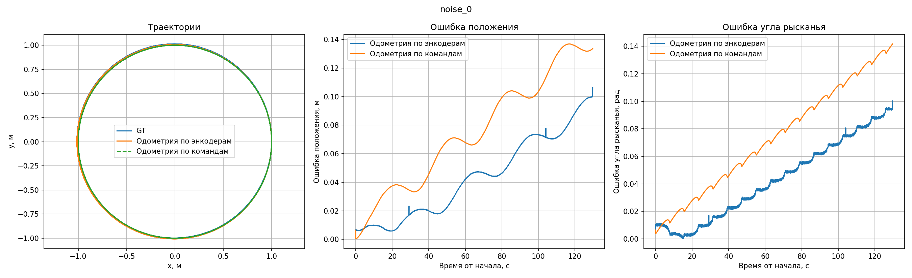
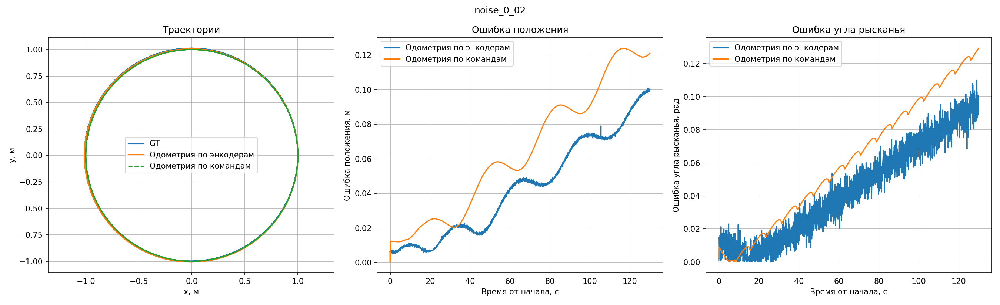
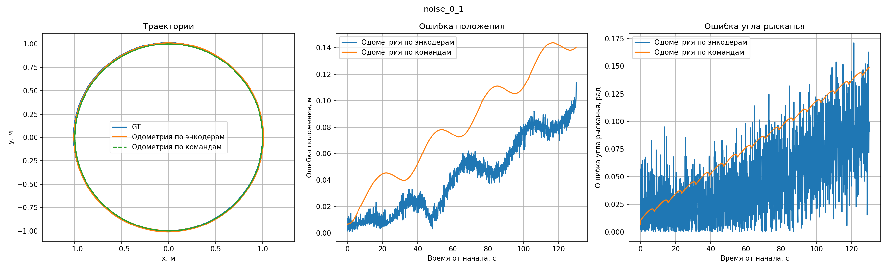

# Практическая работа 3. Одометрия и системы координат

**ФИО:** Шорохов Игорь Дмитриевич  
**Группа:** БПИРС261  
**Вариант:** 18

## Что сделано

Пакет `practice_webots_odometry` построен на примере `example_webots_odometry`:

- Добавлена нода слушающая TF и /clock, которая выводит те самые графики из условия
- Изменен package.xml, setup.py and launch файл для того чтобы эта нода корректно запустилась
## Сборка

В терминале контейнера:

```zsh
cd ~/practices_ws
colcon build --symlink-install --packages-select practice_webots_odometry
source install/setup.zsh
```


## Запуск

В терминале контейнера:

```zsh
cd ~/practices_ws
source install/setup.zsh
ros2 launch practice_webots_odometry spawn_robot.launch.py
```


Можно выбирать миры, например:

```zsh
ros2 launch practice_webots_odometry spawn_robot.launch.py world:=my_world_0_02.wbt
```

Миры различаются только значением `encoderNoise` у `DEF TURTLEBOT`: `my_world_0.wbt` — `0`, `my_world_0_02.wbt` — `0.02`, `my_world_0_1.wbt` — `0.1`. 

```zsh
ros2 launch practice_webots_odometry spawn_robot.launch.py world:=my_world_0_1.wbt run_name:=noise_0_1 output_dir:=results
```

`run_name` — имя файлов результата, `output_dir` — папка для картинки и данных. Между экспериментами меняйте только уровень шума

## Результаты экспериментов


### Без добавленного шума: `encoderNoise 0`

**Изображение:**   
  
**Наблюдения:** Кривые мало отклоняются

### Шум 0,02 рад: `encoderNoise 0.02`

**Изображение:**   
  
**Наблюдения:** чет среднее

### Шум 0,1 рад: `encoderNoise 0.1`

**Изображение:**   
  
**Наблюдения:** Самая нестабильная кривая

## Анализ результатов

- при увеличении уровня шума ошибка будет расти
-


