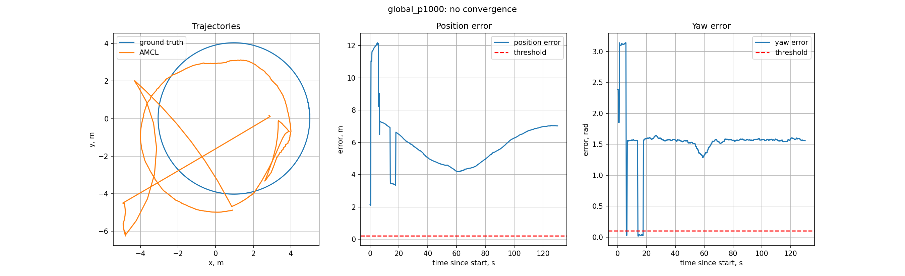
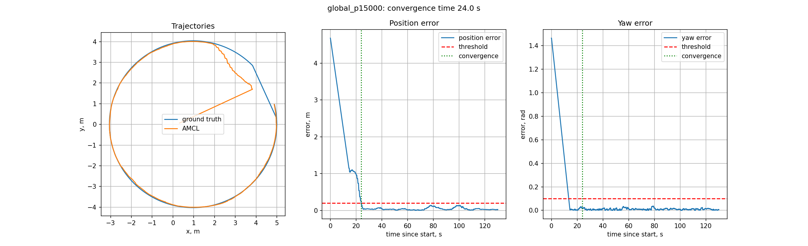
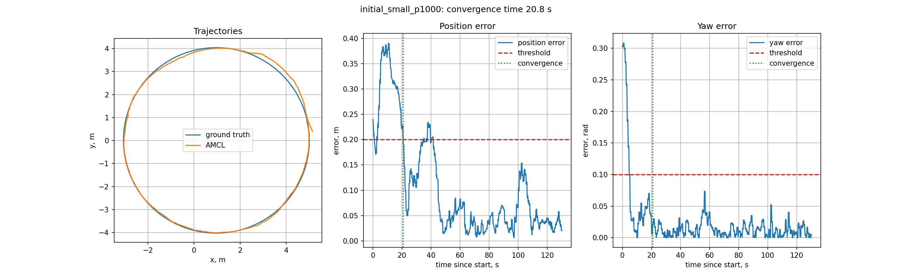
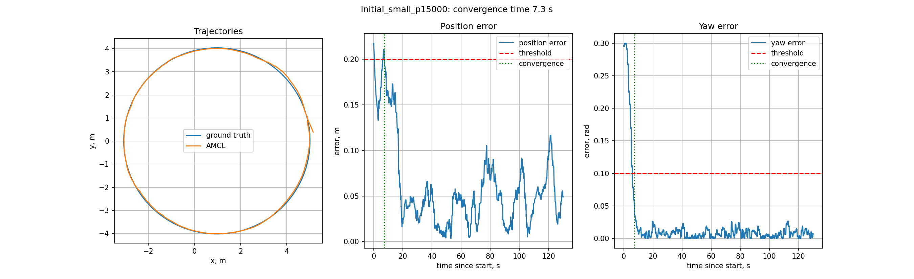
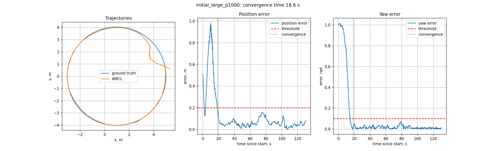
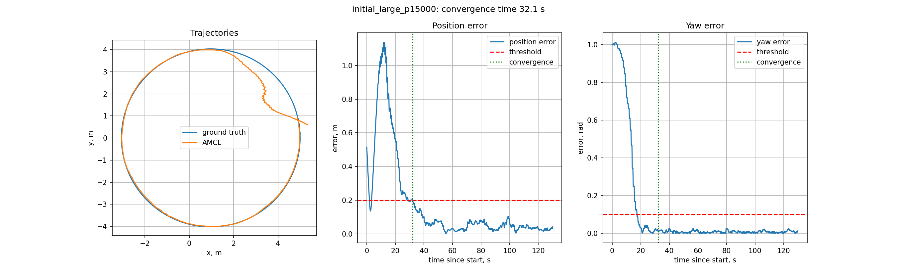

# Практическая работа 4. Локализация на известной карте (AMCL)

**ФИО:** Шорохов Игорь Дмитриевич  
**Группа:** БПИРС261  
**Вариант:** 18

## Что сделано

Пакет `practice_webots_localization` построен на примере `example_webots_localization`:

- Добавлена сцена `my_world` (площадка 12 × 12 м, цифры «1» и «8», робот в точке (5, 0)) и своя карта `maps/my_world.pgm`, сгенерированная скриптом `tools/make_map.py`
- Добавлена нода `convergence_logger`: берет истинную позу из TF `map -> base_link_gt`, оценку AMCL из `map -> base_link`, считает ошибки, время сходимости и рисует графики
- Изменен launch файл: один запуск поднимает сцену, `map_server`, `amcl`, движение по кругу и логгер, после сохранения результата launch завершается сам
- Карта взята из practice-02, параметры, с которыми запускать - тоже. Остальное частично с practice-03
## Критерий сходимости

Эксперимент сошелся, если ошибка положения `e_p < 0,2 м` и ошибка угла `e_ψ < 0,1 рад` держатся непрерывно `5 с`. Любое нарушение сбрасывает отсчет. Время сходимости считается от начала первого такого интервала, от момента появления обеих поз. Данные собираются 130 с, это один круг для моего робота вокруг моих цифр (с моей картой).

Пороги выбраны по трем пробным запускам (`results/prelim`): шум AMCL после 60 с не больше 0,15 м и 0,07 рад, а начальная ошибка малого случая около 0,24 м и 0,3 рад. Порог должен быть между ними.

## Сборка

В терминале контейнера:

```zsh
cd ~/practices_ws
colcon build --symlink-install --packages-select practice_webots_localization
source install/setup.zsh
```

## Запуск

В терминале контейнера:

```zsh
ros2 launch practice_webots_localization spawn_robot.launch.py scene:=my_world localization_mode:=global max_particles:=15000 min_particles:=500 linear_speed:=0.2 angular_speed:=0.05 run_name:=global_p15000 use_rviz:=false
```

`localization_mode` - `global` или `initial`, `error_x`, `error_y`, `error_yaw` - ошибка начальной позы (только для `initial`), `max_particles` и `min_particles` - число частиц, `run_name` - имя файлов результата, `use_rviz:=true` включает RViz. Остальные аргументы в `--show-args`.

Остальные эксперименты отличаются только этими аргументами:

```zsh
localization_mode:=global max_particles:=1000 min_particles:=100 run_name:=global_p1000
localization_mode:=initial error_x:=0.2 error_y:=0.2 error_yaw:=0.3 max_particles:=1000 min_particles:=100 run_name:=initial_small_p1000
localization_mode:=initial error_x:=0.2 error_y:=0.2 error_yaw:=0.3 max_particles:=15000 min_particles:=500 run_name:=initial_small_p15000
localization_mode:=initial error_x:=0.5 error_y:=0.5 error_yaw:=1.0 max_particles:=1000 min_particles:=100 run_name:=initial_large_p1000
localization_mode:=initial error_x:=0.5 error_y:=0.5 error_yaw:=1.0 max_particles:=15000 min_particles:=500 run_name:=initial_large_p15000
```

Запускать по одному, два Webots одновременно не работают. Таблицу ниже можно пересчитать: `python3 practices/practice-04/tools/summary.py`

## Результаты экспериментов

| запуск | время сходимости, с |
|---|---|
| `global_p1000` | нет |
| `global_p15000` | 24,0 |
| `initial_small_p1000` | 20,8 |
| `initial_small_p15000` | 7,3 |
| `initial_large_p1000` | 18,6 |
| `initial_large_p15000` | 32,1 |

### Глобальная локализация, 1000 частиц

**Изображение:**   
**Наблюдения:** не сошелся. Ошибка угла почти все время около π/2, оценка повернута на 90° (возможно, из-за того, что площадка квадратная)

### Глобальная локализация, 15000 частиц

**Изображение:**   
**Наблюдения:** угол сходится к 14 с, положение к 24 с, дальше ошибка в сантиметрах

### Начальная поза, малая ошибка, 1000 частиц

**Изображение:**   
**Наблюдения:** ошибка положения сначала выросла с 0,24 до 0,39 м, потом упала

### Начальная поза, малая ошибка, 15000 частиц

**Изображение:**   
**Наблюдения:** самый быстрый запуск

### Начальная поза, большая ошибка, 1000 частиц

**Изображение:**   
**Наблюдения:** ошибка положения растет до 1 м, пока не исправится угол, потом падает

### Начальная поза, большая ошибка, 15000 частиц

**Изображение:**   
**Наблюдения:** то же самое, но около 10 с ошибка держалась возле порога 0,2 м, поэтому время больше

## Анализ результатов

- Глобальная локализация хуже, чем с начальной позой: с 1000 частицами не сошлась совсем, с 15000 сошлась за 24 с
- Больше частиц лучше для малой ошибки (7,3 с против 20,8 с) и для глобального режима. Для большой ошибки наоборот (32,1 с против 18,6 с), но это скорее случайность одного запуска, ошибка долго была около порога
- После сходимости точность у всех одинаковая: в среднем 0,04-0,06 м и около 0,01 рад
- Запуск на комбинацию один, а AMCL случайный, поэтому разницу в несколько секунд сравнивать нельзя
